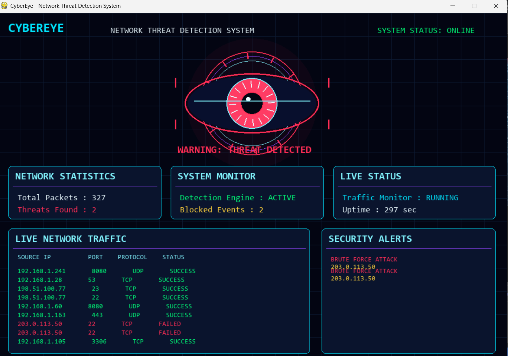

# 👁️ CyberEye – Network Threat Detection Simulator

A Python-based cybersecurity project that simulates network traffic and detects suspicious activities using a rule-based detection engine.

## 🚀 Project Overview

CyberEye is an interactive cybersecurity dashboard featuring a futuristic animated eye that represents continuous network monitoring.

It simulates network packets, analyses connection patterns and generates alerts when suspicious behaviour is detected.

## ✨ Features

- 🔹 Animated cyberpunk-inspired surveillance eye
- 🔹 Simulated network traffic monitoring
- 🔹 Brute-force attack pattern detection
- 🔹 Port-scanning pattern detection
- 🔹 Live security alerts
- 🔹 Network statistics dashboard
- 🔹 Visual threat indication through colour changes

## 🖥️ Project Screenshots

### Normal Monitoring


### Threat Detected


## 🛠️ Technologies Used

- Python 3.13
- Pygame
- Random
- Collections
- Math
- Time

## ⚙️ Installation and Execution

**1. Install Python 3.13**

**2. Install Pygame**

```bash
py -3.13 -m pip install pygame
```

**3. Run the project**

```bash
py -3.13 cyber_eye.py
```

## 🔍 Threat Detection Logic

**Brute-force detection:** Identifies repeated failed connection attempts from the same IP address within a 10-second window.

**Port-scanning detection:** Identifies connections to six or more different ports from the same IP address within a 10-second window.

## ⚠️ Disclaimer

This is an educational cybersecurity simulation that uses generated network traffic and rule-based detection. It does not monitor real network traffic or provide production-grade intrusion detection.

## 🎯 Learning Outcomes

- Understanding network traffic patterns
- Learning basic threat detection techniques
- Applying Python programming concepts
- Developing interactive dashboards using Pygame
- Visualising cybersecurity events

## 👩‍💻 Author

Cybersecurity Student | Python Developer

⭐ Feel free to explore the project and share your feedback!
